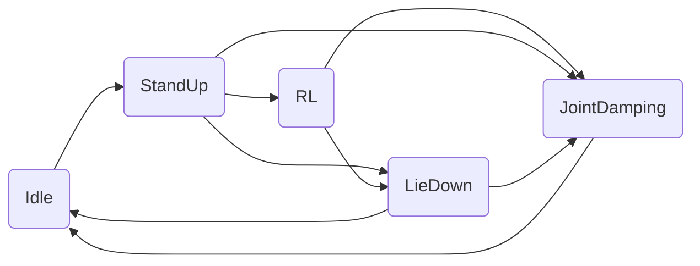
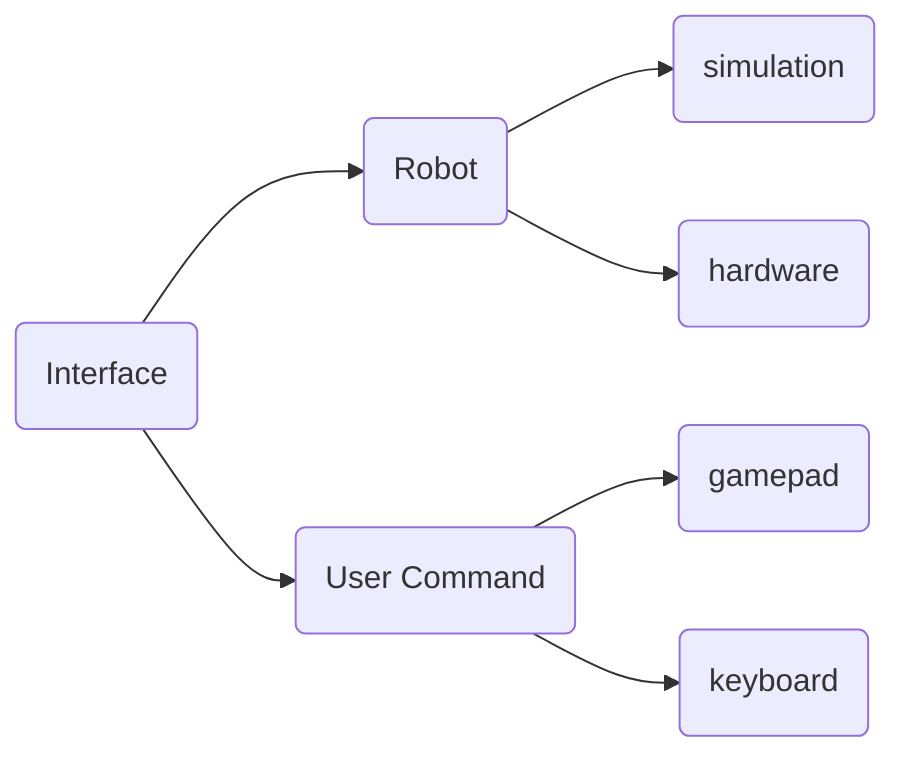

[English](./README_EN.md)

[](https://discord.gg/gdM9mQutC8)

本工程的 Lite3 机器人模型统一放在仓库根目录的 `robot_models/deeprobotics/Lite3/`：
PyBullet 使用其中的 URDF，MuJoCo 使用其中的 MJCF。
`Lite3_description/` 暂时保留验证场景；默认楼梯场景仍在该目录，但其机器人模型引用已指向 `robot_models/`。

请全程在Ubuntu系统上进行
## Tutorial Video
欢迎在[Bilibili](https://b23.tv/UoIqsFn)或者[YouTube](https://youtube.com/playlist?list=PLy9YHJvMnjO0X4tx_NTWugTUMJXUrOgFH&si=pjUGF5PbFf3tGLFz)观看教程视频，学习如何训练和部署强化学习策略。

# 仿真-仿真
```bash
# segmentation debug 工具安装
sudo apt-get install libdw-dev
wget https://raw.githubusercontent.com/bombela/backward-cpp/master/backward.hpp
sudo mv backward.hpp /usr/include

# 依赖安装 (python3.10)
pip install pybullet "numpy < 2.0" mujoco
git clone --recurse-submodule https://github.com/DeepRoboticsLab/rl_deploy.git

# 编译
mkdir build && cd build
cmake .. -DBUILD_PLATFORM=x86 -DBUILD_SIM=ON -DSEND_REMOTE=OFF
# 指令解释
# -DBUILD_PLATFORM：电脑平台，Ubuntu为x86，机器狗运动主机为arm
# -DBUILD_SIM：是否使用仿真器，如果在实机上部署设为OFF 
make -j
```

```bash
# 运行 (打开两个终端)
# 终端1 (pybullet)
cd interface/robot/simulation
python3 pybullet_simulation.py

# 终端1 (mujoco)
cd interface/robot/simulation
python3 mujoco_simulation.py

# 终端2 
cd build
./rl_deploy
```

### 操控(终端2)

tips：可以将仿真器窗口设为始终位于最上层，方便可视化

**键盘控制：**
- z： 机器狗站立进入默认状态
- c： 机器狗站立进入rl控制状态
- x： 机器狗趴下
- r： 关节阻尼模式
- wasd：前后左右
- qe：顺逆时针旋转

**Xbox手柄控制：**

仿真模式下会自动检测Xbox手柄，如果检测到手柄则使用手柄控制，否则使用键盘控制。

- 左肩键 LB：机器狗站立（对应键盘z）
- 右肩键 RB：进入RL控制状态（对应键盘c）
- X：机器狗趴下（对应键盘x）
- 左扳机 LT：关节阻尼模式（对应键盘r）
- 左摇杆 上下：前后移动（对应键盘ws）
- 左摇杆 左右：左右平移（对应键盘ad）
- 右摇杆 左右：转向（对应键盘qe）


# 仿真-实际
此过程和仿真-仿真几乎一模一样，只需要添加连wifi传输数据步骤，然后修改编译指令即可。目前默认实机操控为retroid手柄模式，如需使用键盘模式，可在state_machine/state_machine.hpp中第121行更改为
```bash
uc_ptr_ = std::make_shared<KeyboardInterface>();
```
修改ip：进入jy_exe/conf/network.toml，修改ip为以下内容
```bash
ip = '192.168.2.1'
target_port = 43897
local_port = 43893

ips = ['192.168.1.103']
ports = [43897]
```
```bash
# 电脑和手柄均连接机器狗WiFi
# WiFi名称为 YSC-JYML-xxxxxx
# WiFi密码为 12345678 (一般为这个，如有问题联系技术支持)

# scp传输文件 (打开本地电脑终端)
scp -r ~/rl_deploy ysc@192.168.2.1:~/
# ssh连接机器狗运动主机以远程开发
#Username	Password
#ysc		' (a single quote)
ssh ysc@192.168.2.1
# 输入密码后会进入远程开发模式

# 编译
cd rl_deploy
mkdir build && cd build
cmake .. -DBUILD_PLATFORM=arm -DBUILD_SIM=OFF -DSEND_REMOTE=OFF
# 指令解释
# -DBUILD_PLATFORM：电脑平台，Ubuntu为x86，机器狗运动主机为arm
# -DBUILD_SIM：是否使用仿真器，如果在实机上部署设为OFF 
make -j 
./rl_deploy
```

## 操控(手柄)

参考https://github.com/DeepRoboticsLab/gamepad

- Y：机器狗站立
- A：进入RL控制状态
- X：机器狗趴下
- 同时按下左右摇杆：关节阻尼模式
- 左摇杆：前后左右移动
- 右摇杆：顺逆时针旋转

## 模型转换

使用训练工程的 `play.py` 导出指定 checkpoint，导出时会保留训练策略的观测结构和归一化参数：

```bash
cd /home/robot/pengyingjian_external/quadruped_robot/rl_training
TERM=xterm /home/robot/isaacsim/IsaacLab/isaaclab.sh -p \
  scripts/reinforcement_learning/rsl_rl/play.py \
  --task QuadrupedRobot-Velocity-Flat-Deeprobotics-Lite3-v0 \
  --checkpoint_path logs/rsl_rl/deeprobotics_lite3_flat/<run>/model_<iteration>.pt \
  --export_onnx --device cpu
```

ONNX 会写入 checkpoint 同级的 `exported/` 目录。当前 Lite3 策略输入为 47 维，其中最后两维是周期 0.6 s 的正弦/余弦步态相位；部署 runner 也兼容旧的 45 维策略。runner 会读取 ONNX 的输入形状，拒绝不支持的维度，并将控制更新周期设为 20 ms（50 Hz），与 Isaac Lab 的 `dt=5 ms × decimation=4` 对齐。

### ONNX runner 冒烟测试

构建并测试仓库中的默认 ONNX 策略：

```bash
cd /home/robot/pengyingjian_external/quadruped_robot/rl_deploy
cmake -S . -B /tmp/lite3_deploy_build -DBUILD_SIM=OFF -DBUILD_PLATFORM=x86 -DBUILD_POLICY_TESTS=ON
cmake --build /tmp/lite3_deploy_build --target lite3_policy_runner_smoke -j2
cd /tmp/lite3_deploy_build && ctest --output-on-failure
```

验证某个训练 checkpoint 导出的 ONNX（包括当前 47 维策略）：

```bash
/tmp/lite3_deploy_build/lite3_policy_runner_smoke \
  /path/to/run/exported/model_<iteration>.onnx
```


## 各模块介绍

### state_machine




state_machine模块是Lite3在不同的状态之间来回切换，不同的状态代表的功能如下：

1.Idle 空闲状态，表示机器狗处于关节不发力的情况

2.StandUp 站起状态，表示机器狗从趴下到站起的动作

3.RL RL控制状态，表示机器狗执行策略输出的action

4.JointDamping 关节阻尼状态，表示机器狗的关节处于阻尼控制状态

5.LieDown 趴下状态，表示机器狗从站立状态切换到趴下状态，动作完成后回到Idle

### interface



interface模块表示机器狗的数据接受和下发接口和手柄控制的输入。其中机器狗平台的输入分为仿真和实物，手柄的输入分为键盘和手柄控制。

### run_policy


这部分用于执行RL策略的输出，新的策略可以通过继承policy_runner_base实现。
